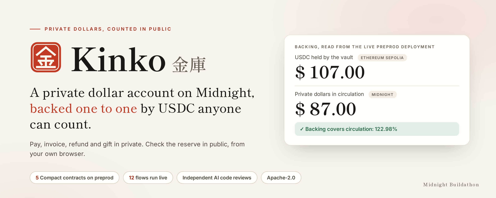
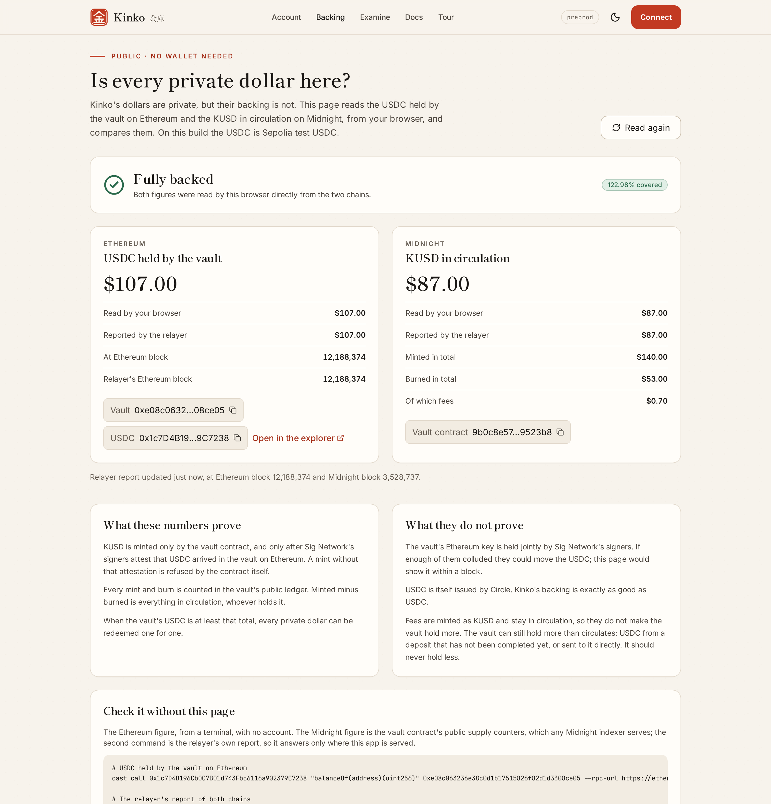
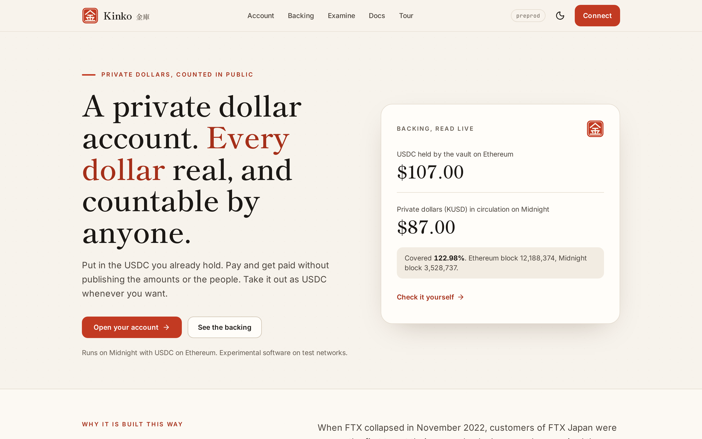
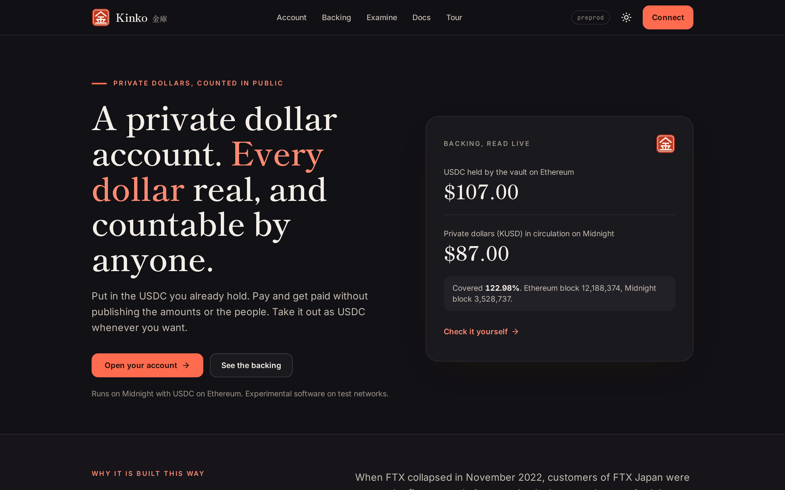
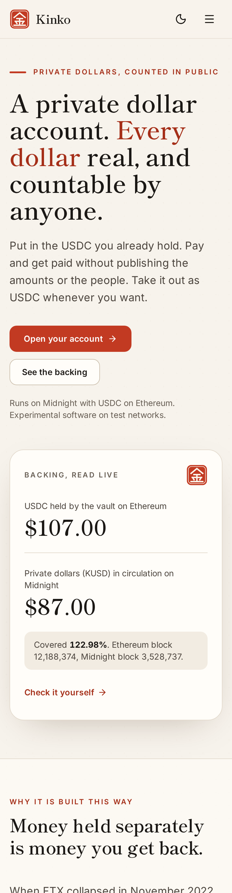
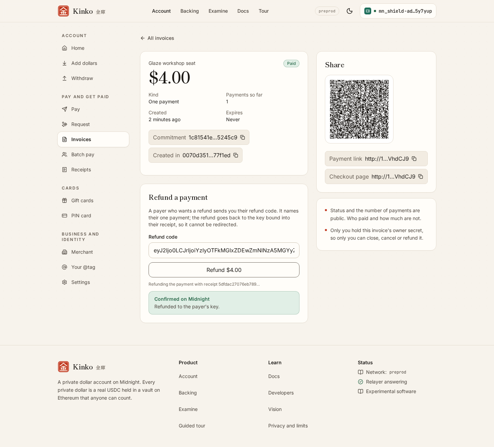
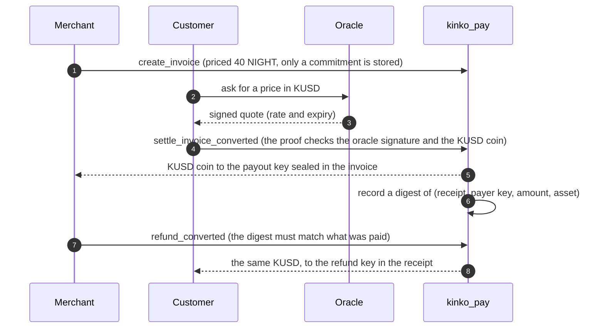
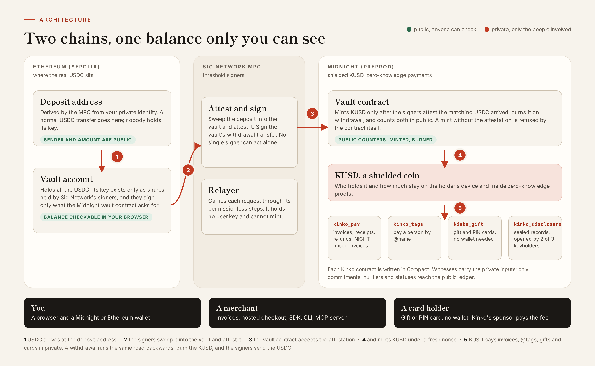

<p align="center"></p>

<p align="center">
  <a href="LICENSE"></a>
  
  
  
  
  
</p>

<p align="center">
  <b><a href="#how-judges-can-test-it">How judges can test it</a></b> ·
  <b><a href="#live-contracts-on-midnight-preprod">Deployed contracts</a></b> ·
  <b><a href="#how-it-works">Architecture</a></b> ·
  <b><a href="#midnight-integration">Midnight integration</a></b> ·
  <b><a href="#reviews-what-independent-reviewers-found-and-what-changed">Reviews</a></b> ·
  <b><a href="docs/THREAT-MODEL.md">Threat model</a></b> ·
  <b><a href="#who-it-is-for-and-who-pays">Who pays</a></b> ·
  <b><a href="#limits-stated-plainly">Limits</a></b>
</p>

**Kinko** is a private dollar account on Midnight, backed one to one by USDC that anyone can count. You put USDC into a vault on Ethereum and hold the same amount of KUSD on Midnight, where only you can see it. You pay invoices, pay people by `@name`, refund a customer, hand someone a gift card they can open with no wallet, and take your dollars back out as USDC whenever you like. The backing is public: every KUSD in circulation is matched by USDC in the vault, and any browser can read both chains directly, without trusting Kinko.

Two things usually go wrong with money held on someone else's books. Either it is private but you must trust that it exists, or it is provable but every payment is public. Kinko keeps payments private and the reserve public. KUSD can only be minted by the vault contract, and only after Sig Network's signers attest that the matching USDC arrived; a mint without that attestation is refused by the contract itself.

Built for the [Midnight Buildathon](https://app.akindo.io/) on Midnight's Night Mode: the vault is a Midnight contract that controls an Ethereum account through Sig Network's MPC. **Experimental software on test networks, not audited by a human, not for funds you cannot afford to lose.**

**Contents:** [At a glance](#at-a-glance) · [How judges can test it](#how-judges-can-test-it) · [What it looks like](#what-it-looks-like) · [What works today](#what-works-today) · [Midnight integration](#midnight-integration) · [How it works](#how-it-works) · [Reviews](#reviews-what-independent-reviewers-found-and-what-changed) · [Alternatives](#alternatives-and-what-kinko-adds) · [Who pays](#who-it-is-for-and-who-pays) · [Tests](#tests-and-evidence) · [Limits](#limits-stated-plainly) · [Privacy review with Tell](#privacy-review-with-tell) · [Repository](#repository) · [Run it locally](#run-it-locally) · [Run it on preprod](#run-it-on-preprod) · [Roadmap](#roadmap) · [Credits](#credits) · [Licence](#licence)

## At a glance

| Topic | Detail |
|---|---|
| **What it is** | A private dollar account: USDC in on Ethereum, shielded KUSD on Midnight, USDC back out. Invoices, receipts, refunds, `@tags`, batch pay, gift cards, PIN cards, examiner disclosure, and a merchant SDK, CLI and MCP server. |
| **Networks** | Midnight preprod, Ethereum Sepolia, Sig Network's testnet MPC. Nothing is on a mainnet. |
| **Contracts** | Five Compact contracts live on preprod: the vault (adapted from Sig's examples, with public mint and burn counters added) and Kinko's own `kinko_pay` (14 circuits), `kinko_tags` (4), `kinko_gift` (4) and `kinko_disclosure` (5). |
| **Live evidence** | All 12 end-to-end flows pass on preprod, each checked on both chains, not just on screen. |
| **Tests** | 2,425 unit, simulator and integration tests passing, plus 114 browser tests with a mocked chain. Every `assert` in the three payment contracts (`kinko_pay`, `kinko_tags`, `kinko_gift`) is tripped by a test. |
| **Reviews** | The pay contract was reviewed repeatedly by separate AI agents (read-only). Every defect they found is fixed and covered by a test, and for the later fixes the test was checked to fail when the fix is removed. Not a human audit. |
| **Licence** | Apache-2.0, including all Compact code. |

## How judges can test it

There is no hosted public build yet (see [Limits](#limits-stated-plainly)); the app is served from the developer's machine. What you can verify without our server:

**1. On chain, with no account.** The deployed contracts are listed [below](#live-contracts-on-midnight-preprod) with their deploy transactions. The reserve is checkable from a terminal:

```bash
# USDC held by the vault on Ethereum Sepolia (the Backing page reads this in the browser)
cast call 0x1c7D4B196Cb0C7B01d743Fbc6116a902379C7238 "balanceOf(address)(uint256)" 0xe08c063236e38c0d1b17515826f82d1d3308ce05 --rpc-url https://ethereum-sepolia-rpc.publicnode.com
```

KUSD in circulation is the vault contract's own public counters, minted minus burned, which any Midnight indexer serves; the app's Backing page compares the two and shows the result live (see the [screenshot](#what-it-looks-like)).

**2. The contract tests, with no network, in a few minutes.**

```bash
compact update 0.36.0
yarn install
yarn workspace @kinko/kinko-pay compile     # compiles kinko_pay, kinko_tags and kinko_gift, without proving keys
yarn workspace @kinko/kinko-pay test        # 237 tests, in a simulator that runs the compiled contract
```

**3. The whole product, locally.** [Run it locally](#run-it-locally) starts a full stack (Midnight node, indexer, proof server, a forked Ethereum, Sig's test MPC, the relayer, backend, sponsor and snapshot service). `yarn workspace @kinko/web e2e:live` then runs the 12 flows below in a real browser. [Run it on preprod](#run-it-on-preprod) does the same against the live testnets.

**4. Where each thing is.**

| You are looking for | Where |
|---|---|
| A Compact contract that compiles | [`contracts/kinko-pay/src/kinko_pay.compact`](contracts/kinko-pay/src/kinko_pay.compact) (14 circuits, 28 proving and verifying keys), plus [`kinko_tags`](contracts/kinko-pay/src/kinko_tags.compact), [`kinko_gift`](contracts/kinko-pay/src/kinko_gift.compact) and [`kinko_disclosure`](contracts/kinko-disclosure/src/kinko_disclosure.compact) |
| Witnesses and commitments | [`contracts/kinko-pay/src/pay-witnesses.ts`](contracts/kinko-pay/src/pay-witnesses.ts): 26 witnesses; invoices, receipts and refunds are bound by `persistentHash` commitments |
| Tests that assert contract state | [`contracts/kinko-pay/test`](contracts/kinko-pay/test): 18 files, 237 tests. `assert-coverage` fails if any `assert` in the three payment contracts is never tripped; `witness-single-read` pins how many times each witness is read in each circuit; `privacy-observer` searches everything the ledger exposes for the private values and must find none |
| A frontend that writes and reads the contract | [`apps/web`](apps/web): React and Vite, connected through the Midnight DApp Connector (and NightKit for Ethereum sign-in); the Backing page, invoice status and receipts read the chain back |
| Deployed addresses | [Live contracts](#live-contracts-on-midnight-preprod) and [`deployments/preprod.json`](deployments/preprod.json) |

### Live contracts on Midnight preprod

| Contract | Address | Deploy transaction |
|---|---|---|
| Vault (mints and burns KUSD, public counters) | [`9b0c8e57…9523b8`](https://preprod.midnightexplorer.com/contracts/9b0c8e579e0118e6a0ea8e67ff9029221a267888aa131c3ddd468c978e9523b8) | deployed by `yarn deploy-initialise:erc20-vault` (see [Run it on preprod](#run-it-on-preprod)) |
| `kinko_pay` | [`4b1d82f3…54459c`](https://preprod.midnightexplorer.com/contracts/4b1d82f36cfe6f68d92bbfd6f4bd508b8665abc4a2b99ba0b567cc3d2954459c) | `0071a82372afe7681098610f02216d452e89c1d2c0d4f1cdf92f5d83570c267217` |
| `kinko_tags` | [`8cc4d907…c99e1`](https://preprod.midnightexplorer.com/contracts/8cc4d90796c02827c52154a53d68b415e531a8aa87d203ccb8a6934a0eac99e1) | `007b0f0f8a3dc2db4e606887e1db2da5f312e15ddbf3fb3d541e006a5cc685bbe9` |
| `kinko_gift` | [`d7c38b41…8dee7d`](https://preprod.midnightexplorer.com/contracts/d7c38b41ec3e65b5ef81851da07ee06de8cef231710d2103b58e4acd4a8dee7d) | `00e01c07043d862949cb06b22b4acd2787188b44db7ee366dcecd194fb3bc35bce` |
| `kinko_disclosure` | [`37fb8cfd…23e4f8`](https://preprod.midnightexplorer.com/contracts/37fb8cfde520ce7589f7cda4ca073f47e75d011ad4b87a194242f6c90123e4f8) | `00052b98f30f5ea34071329c3723ee466bdc01529489b4d24de951be6b42094737` |

Full addresses: vault `9b0c8e579e0118e6a0ea8e67ff9029221a267888aa131c3ddd468c978e9523b8`, `kinko_pay` `4b1d82f36cfe6f68d92bbfd6f4bd508b8665abc4a2b99ba0b567cc3d2954459c`, `kinko_tags` `8cc4d90796c02827c52154a53d68b415e531a8aa87d203ccb8a6934a0eac99e1`, `kinko_gift` `d7c38b41ec3e65b5ef81851da07ee06de8cef231710d2103b58e4acd4a8dee7d`, `kinko_disclosure` `37fb8cfde520ce7589f7cda4ca073f47e75d011ad4b87a194242f6c90123e4f8`. The USDC is Sepolia test USDC `0x1c7D4B196Cb0C7B01d743Fbc6116a902379C7238`; the vault's Ethereum account is `0xe08c063236e38c0d1b17515826f82d1d3308ce05`. `kinko_pay` was redeployed several times while independent reviews found defects (see [Reviews](#reviews-what-independent-reviewers-found-and-what-changed)); the address above is the final one, and `deployments/preprod.json` records it.

## What it looks like

These are screenshots of the real preprod build (no mocked data): the backing page below reads the live vault and the live Midnight supply counters. The sources are in [`docs/readme`](docs/readme); `node docs/readme/shots.mjs` retakes them.

<p align="center"></p>

The vault holds $20 more than KUSD in circulation because three test deposits were swept and attested but never claimed: their USDC sits in the vault and their KUSD was never minted (traced from the relayer's record; the chain's own history is pruned on the public RPC). The vault should never hold less, and the page would show it within a block.

| Landing, light | Landing, dark | On a phone |
|---|---|---|
|  |  |  |

<p align="center"></p>

Above: a merchant refunds a payment on preprod with the customer's refund code. The refund goes back to the key bound into the receipt, so it cannot be redirected.

## What works today

Every flow below runs in a real browser against real Midnight infrastructure: on a local stack, and on Midnight preprod with real Sepolia and Sig Network's testnet MPC, against Kinko's own deployed contracts. Each test checks the result on both chains, not just the screen. Steps wait for real blocks and finality, so a flow takes minutes.

| Flow | What the test does | Run live on preprod |
|---|---|---|
| Deposit | $50 of USDC reaches a deposit address by an ordinary transfer; the app starts the deposit, the relayer carries it, the user mints $50 of KUSD. Checks the shielded balance, the vault's USDC and the public backing page. | Yes, about 30 minutes ($60), waiting on the MPC |
| Invoice payment | A merchant creates a $12.50 request; a customer opens the link in another browser and pays from their private balance. Checks both wallets' balances and the merchant's invoice status. | Yes, 1.8 minutes |
| Hosted checkout | A merchant's server starts a draft through the SDK; the merchant's wallet creates the invoice from the draft link; a customer pays on the hosted checkout page. Checks that the backend sees the session settle from the chain, and the merchant's balance. | Yes, 1.5 minutes |
| Refund | A customer pays, then gives the merchant their refund code; the merchant refunds from the invoice page. Checks both balances return to where they started and that a second refund is refused. | Yes, 2.7 minutes |
| Invoices from the SDK, CLI or MCP server | An invoice built on the merchant's machine is published from the app's Invoices page and paid from its own link. Checks the merchant's balance and the invoice status. | Yes, 1.5 to 2.3 minutes |
| Batch pay | A payer pastes a payroll file; the page names its bad line and refuses to pay, then pays the corrected file in one private transfer. Checks the recipient's balance. | Yes, under a minute |
| Examiner disclosure | An account holder files a sealed statement; the operator registers an examiner; the examiner opens a case naming it; after one keyholder's approval the record stays sealed, after a second it opens and is checked against its on-chain anchor. | Yes, 3.1 minutes |
| Gift card | An issuer funds a $2.50 card and sends its link; the recipient opens it with no wallet, sees it is genuine and what it holds, then moves it into their own account. Checks the card's balance on chain before and after, and the recipient's balance. | Yes, 1.6 to 2.4 minutes |
| PIN card | An owner makes a card loaded with $3; someone holding the card and its PIN pays a $1.25 invoice with no wallet, Kinko's sponsor paying the fee; the owner's wrong PIN is refused; freezing moves the remaining $1.75 back. Checks the merchant's, the card's and the owner's balances on chain. | Yes, 3.1 to 4 minutes |
| Invoice priced in NIGHT | The SDK prices an invoice at 40 NIGHT; the customer pays the KUSD Kinko's oracle quotes from NIGHT's live USD price, rounded up to a whole cent, and the contract verifies the oracle's signature inside the proof. NIGHT exists only unshielded, so this is how such an invoice is paid. Checks both KUSD balances move by the quoted price. | Yes, 3.3 to 4 minutes |
| Pay by @tag | A merchant claims a tag; a customer pays $3 to it by name. Checks the merchant's balance. | Yes, 1.3 minutes |
| Withdraw | A user withdraws $10 of KUSD to a fresh Ethereum address. Checks the USDC that arrives, the KUSD burned with the fee, and the backing page. | Yes, about 28 minutes ($2), waiting on the MPC |

Run them yourself with `yarn workspace @kinko/web e2e:live` once the stack is up. The suite lives in [`apps/web/e2e/live`](apps/web/e2e/live). Also in the product, tested in the contract simulator and unit suites: multi-payer and donation invoices, receipts and receipt proofs, revenue attestations, the merchant SDK, CLI and MCP server for AI assistants, and the Telegram bot.

**Run live from Node on preprod, against the final `kinko_pay`:**

- `smoke:pay` creates and pays a $1 invoice with real proofs.
- `smoke:batch` runs the contract's batch circuit, which the app does not use (it pays a batch as plain transfers): four invoices paid in one proof, every receipt matching the one the app recomputes, one payment refunded to the payer's key, a second refund refused.
- A card payment is refunded back to the card (the card's balance returns to what it was); a payer who lost a refund code finds it again on the Receipts page and the merchant refunds with it.
- A card opened from a snapshot whose tree had every hash changed still opened and spent (the forged-tree specs, `13-forged-tree` and `14-forged-tree-spend`).

A new card opens in seconds. On preprod the gift card flow went from 23.6 minutes to 1.8 and the PIN card flow from 2.3 hours to 2.7, because a card starts from the chain's tree at its birth instead of replaying every event (see [Opening a card fast](#how-it-works)). A gift card run with `KINKO_LIVE_FULL_REPLAY=1` read the balance by replaying the whole chain from the first event instead, and agreed.

## Midnight integration

Kinko uses the parts of Midnight that make private money possible, and keeps what must be checkable on the public ledger.

- **Shielded coins.** KUSD is a shielded token. A payment forwards a coin to the key sealed in the invoice (`forward(coin, payout)`), so the chain sees that a valid payment happened, not the amount, the payer or the payee.
- **Private state through witnesses.** Amounts, merchant keys, payout keys, owner secrets and payer secrets are witnesses: they live on the user's device and enter only as inputs to a proof. Invoices are stored as a single commitment, `persistentHash` over the merchant, payout, amount, kind, asset, a fresh salt and the owner's tag, so equal invoices never look equal.
- **Zero-knowledge checks inside the circuit.** Settlement proves the coin is worth exactly the committed amount and is KUSD. A NIGHT-priced invoice is paid in KUSD at the oracle's signed rate, and the contract verifies the oracle's Schnorr signature inside the proof (`jubjubSchnorrVerify`) and checks the quote has not expired (`blockTimeLt`).
- **A Merkle tree for selective disclosure.** Every receipt goes into a historic Merkle tree, so a merchant can prove their revenue over four payments is at least a threshold without revealing any amount, payer or which payments were counted (`attest_revenue_at_least`).
- **Cross-chain through Sig's MPC.** The vault contract controls an Ethereum account through Sig Network's MPC (Night Mode). Deposits and withdrawals are requests the vault queues and the signers answer.

### The four contracts Kinko wrote

| Contract | Circuits that change state | Ledger | What it does |
|---|---|---|---|
| [`kinko_pay`](contracts/kinko-pay/src/kinko_pay.compact) | `create_invoice`, `settle_invoice`, `settle_invoice_converted`, `close_invoice`, `cancel_invoice`, `refund_payment`, `refund_converted`, `attest_revenue_at_least`, `settle_batch` (plus views: `invoice_exists`, `is_settled`, `receipt_exists`, `is_refunded`, `attestation_exists`) | 11 fields | Invoices (standard, multipay, donation), settlement in KUSD or NIGHT, receipts, refunds, revenue attestations. Plus 13 pure circuits the app uses to recompute commitments and receipts. |
| [`kinko_tags`](contracts/kinko-pay/src/kinko_tags.compact) | `register_tag`, `update_tag_keys`, `transfer_tag`, `release_tag` | 1 | `@names` that resolve to a person's receiving keys. |
| [`kinko_gift`](contracts/kinko-pay/src/kinko_gift.compact) | `issue`, `void_card` (plus two views) | 3 | A registry of gift-card commitments, so a recipient can check a card is genuine and not voided. Holds no value. |
| [`kinko_disclosure`](contracts/kinko-disclosure/src/kinko_disclosure.compact) | `file_record`, `register_examiner`, `revoke_examiner`, `open_case`, `approve_case` | 12 | Records sealed to an examiner key, opened only when two of three keyholders approve, with a public log. |

### What `kinko_pay` puts on the public ledger, and what it keeps off

| Public ledger | Never on the ledger |
|---|---|
| The invoice commitment (an opaque hash) and its status, kind, asset, expiry and the number of payments | The amount, the merchant, the payout key, the payer, any title or memo |
| The owner tag (a hash of a secret only the merchant holds) | The owner secret itself |
| A settlement nullifier per payment, which stops a replay and links to no one | Who paid, and the payer's secret key |
| A receipt digest and a Merkle tree of receipts, meaningless alone | What the receipt is worth |
| A refund tag, saying one public receipt was refunded | Where the refund went |
| A digest and a mark for payments made through conversion | The converted amount: its digest includes the payer's secret key |
| The sealed oracle key and the sealed KUSD colour | |

The [`privacy-observer`](contracts/kinko-pay/test/privacy-observer.test.ts) test makes this a checked claim: it deploys the contract, runs payments, and searches everything an observer can see (ledger state and every transaction's public transcript) for each private value. It must find none, and it first proves its own search finds a value that is public by design.



## How it works

<p align="center"></p>

- **Deposit.** USDC goes to an address the MPC derives from the user's private identity; nobody holds its key. The user signs `startDeposit`; the relayer carries the request through the vault queue, the signers sweep the USDC into the vault and attest it; the user signs `completeDeposit` and receives KUSD under a fresh nonce that cannot be linked to the deposit.
- **Pay.** Settling an invoice proves, in zero knowledge, that the coin is worth exactly the committed amount and is KUSD, then forwards it to the merchant's key sealed in the invoice. The chain records that the invoice was paid, not the amount, the payer or the merchant.
- **Withdraw.** The user burns KUSD and names an Ethereum address; the signers send the USDC from the vault. If the transfer fails, closing the withdrawal mints the KUSD back, less the fee, which the vault keeps.
- **Cards.** A gift card or PIN card is a Midnight wallet whose 24-word phrase comes from the card (and, for a PIN card, the PIN, stretched with scrypt). It pays any invoice with real proofs but holds no DUST, so it binds its transaction with only its own value balanced and hands it to a fee payer: Kinko's sponsor at a checkout, or the holder's own wallet when moving the balance into their account. The sponsor can add a fee and nothing else.
- **Opening a card fast.** A wallet that has never synced replays every shielded event the chain has recorded, which on a public network is millions. A card is new, so nothing can have been paid to it before it was made, and it needs no event before that. The card's link carries its birth: the last event the snapshot service's published tree had applied when the card was made, and the chain's identity. The service (`services/snapshots`) follows the chain with a wallet that holds no coin and publishes its commitment tree; a card opened with a birth starts from the newest published tree at or before it and replays only what came after. The tree is public data, published with placeholder keys (a card swaps in its own), so it names no wallet. The app starts a card from a snapshot only if it is for the right network and format, carries no coin and no deferred coin check, and was taken at or before the card's birth; a tree that does not match the chain stalls the wallet, and after 45 seconds without progress the card starts again from the first event. The card page offers "Read the whole chain" for a card that shows less than expected, which ignores the snapshot entirely. What cannot be checked here is that the tree is the chain's right one: the service is believed only as far as those checks reach. Run on preprod, a tree with every hash changed (the same size, all 32 of its hashes wrong) still opened from the snapshot and the card still spent; why was not established (see the [threat model](docs/THREAT-MODEL.md)). Snapshots older than 30 days are dropped apart from the newest, so a card opened later than that gets no match and takes the slow way. The service sees when a card is made and when it is opened, with the caller's address, and the indexer sees the event a card starts from; neither sees a key, an amount or a balance, but a service operator could link the two requests. A card with no birth still opens the slow way. A recovery phrase can carry the birth as a 25th item after the 24 words (the card's page shows it beside the phrase, and other wallets take the 24 words alone), and the unlock field reads it; a phrase pasted without it replays the chain.
- **Examine.** A merchant can file records sealed to an examiner key. An examiner opens a case naming specific records; two of three keyholders must approve before anything opens, and every disclosure is logged on chain.

More: [architecture](docs/ARCHITECTURE.md), [threat model](docs/THREAT-MODEL.md).

## Reviews: what independent reviewers found, and what changed

The pay contract was reviewed repeatedly by separate Claude agents (Opus), read-only, given the source and tests and asked to find defects rather than confirm the work. They are not a human audit and do not replace one. Each fix below has a test; for the later fixes the test was checked by deleting the fix and watching it fail. The full list, with the tests, is in the [threat model](docs/THREAT-MODEL.md).

| What a review found | What changed | Evidence |
|---|---|---|
| Settlement, converted settlement and refund each read the invoice amount (and settlement the payout) **twice**; a prover can answer a witness differently each time, so the commitment and the amount checked could disagree | Every witness is read exactly once per circuit | [`witness-single-read.test.ts`](contracts/kinko-pay/test/witness-single-read.test.ts) pins the read count of every witness in every circuit |
| A payment link could be used before the merchant published the invoice, so someone else could create the same terms first | The owner's tag is part of the commitment; only the holder of the owner secret can publish what a link names | `kinko-pay.test.ts`, "invoice squatting" |
| An invoice priced in NIGHT and paid in KUSD could not be refunded. The first fix let the payer's editable refund code set the amount and accepted any receipt | `refund_converted` returns the KUSD that was paid. Settlement records a digest of (receipt, payer key, amount, asset); the refund recomputes it. The payer's key is in the hash, so the amount stays private | [`refund-converted.test.ts`](contracts/kinko-pay/test/refund-converted.test.ts) |
| `refund_payment` still accepted a payment made through conversion, so a merchant could pick the cheaper of two refunds and bar the other | Settlement marks converted receipts and `refund_payment` refuses them | same file |
| A holder of a receipt-proof link could write a refund code with another encryption key; the merchant's refund then went to the payer's key but could not be read by the payer, and the refunded tag was spent | The payer's encryption key is bound into the receipt beside the refund key, so a code that names another key names no payment | `refund.test.ts`, "REFUSES a refund encrypted to any key but the one the payer named" |
| Third review: no contract defect. It found wording that overstated what the contract enforces, an app message that pointed to a recovery path that did not exist, and tests that would pass if the batch or attestation path were broken | The threat model and code comments now say the circuit checks the key a merchant client supplies and the wallet does the encrypting; the Receipts page shows the payer's refund code again; new tests recompute batch receipts, give each attested payment its own encryption key and search the ledger view for the encryption key | commit history |

Also fixed after earlier reviews: the fee sponsor refuses a duplicate transaction by its canonical digest ([`services/sponsor`](services/sponsor)); the Backing page reads the USDC balance from the ledger-named vault account and shows no verdict on a mismatch; the app checks a deposit address against the pinned vault and the MPC's key before showing it; the relayer takes the client address from the rightmost forwarded entry; published card snapshots carry placeholder keys. Each has tests.

## Alternatives, and what Kinko adds

Private stablecoin payments are not new, and Kinko does not claim to be the first. What exists today, from the projects' own pages:

| | What it is | What differs from Kinko |
|---|---|---|
| [USDCx on Aleo](https://aleo.org/post/aleo-circle-launch-of-usdcx/) | A private stablecoin on Aleo backed 1:1 by USDC held in Circle's xReserve contract, bridged from networks like Ethereum, launched on testnet in December 2025 and listed by Aleo as available on mainnet; designed to meet compliance standards ([Circle](https://www.circle.com/blog/usdcx-on-aleo-testnet-via-circle-xreserve)) | A different chain, and Circle-issued and operated. Kinko runs on Midnight and adds the payments layer (invoices, receipts, refunds, cards, examiner disclosure). |
| [Railgun](https://blockworks.co/news/defi-privacy-zero-knowledge-proofs) | A shielded pool on Ethereum: balances are encrypted notes, every action carries a zk-SNARK, and a Private Proof of Innocence screens deposits against blocklists. A [2026 study](https://arxiv.org/pdf/2606.25926) measures how much anonymity users lose in practice | A general shielded pool, not a backed dollar with a public reserve check, and no invoice or refund layer. |
| [zk.money (Aztec)](https://decrypt.co/379621/ethereum-privacy-aztec-brings-back-zk-money) | The original was wound down in 2023 with Aztec Connect's sunset ([The Block](https://www.theblock.co/post/219253/aztec-to-sunset-private-zk-rollup-connect-and-focus-on-next-gen-layer-2-chain)); Aztec relaunched it in September 2026 as a self-custodial wallet where payments are private but deposits from Ethereum remain public, with an early cap of $2,500 per transaction | Kinko also shows deposits and withdrawals on Ethereum. It differs in making the reserve a number you can check, and in the merchant tools. |
| A custodial stablecoin or an exchange balance | Private from other users only if the custodian says so, and provable only by trusting a report | Kinko's claim is the opposite: private payments, a reserve anyone can count. |

**What Kinko adds:** a backing figure any browser verifies from the two chains with no account (the Backing page); one deployed system covering the whole payment life cycle (invoice, receipt, refund, NIGHT-priced invoice, batch, gift card, PIN card, selective disclosure) rather than a transfer primitive; and a gift or PIN card that pays an invoice with no wallet, with Kinko's sponsor paying the fee.

**What it costs, stated plainly:** Kinko's reserve is held by Sig Network's threshold signers, so it is a trust assumption (a threshold of them colluding could move the USDC, and the Backing page would show it within a block). USDC is itself issued by Circle. And everything here is on test networks.

## Who it is for, and who pays

**Who uses it:** a business that pays contractors and staff from one file without publishing a payroll; a freelancer who shares a `@tag` or a payment link so income from one client never reveals income from another; an examiner (an accountant or regulator) who sees only the records named in a case, after two of three keyholders approve, each checked against its on-chain anchor.

**Who pays: hypotheses, nothing sold yet.** There is no revenue, no pilot and no paying user.

| Stream | Who | Status |
|---|---|---|
| A flat withdrawal fee | Anyone withdrawing USDC | Already in the vault: charged on withdrawal, minted back as KUSD and kept in circulation (the preprod profile sets 0.10 USDC; the vault has collected $0.70 so far) |
| A paid tier of merchant tools | Shops and services using hosted checkout, webhooks and the SDK | Hypothesis. The tools exist; no price has been tested |
| Private payroll runs | Teams and DAOs paying many people | Hypothesis. Batch pay exists; no price has been tested |
| Compliance-friendly disclosure | Businesses answering an auditor | Hypothesis. The examiner flow exists; no buyer has been asked |

The honest size of the market is not measured here: no customer discovery has been done, and no number is claimed.

## Tests and evidence

```bash
yarn test                            # unit, simulator and integration suites across every workspace
yarn workspace @kinko/web e2e        # every page in four looks (desktop and phone, light and dark), with a mocked chain: 114 tests
yarn workspace @kinko/web e2e:live   # the 12 real flows above, against a running stack
yarn lint
```

Counts from a full run (Node 22, WSL). The live and Docker-stack suites are skipped unless the stack is running, and say so:

| Workspace | Test files | Tests passing |
|---|---|---|
| `contracts/kinko-pay` | 18 | 237 |
| `contracts/kinko-disclosure` | 8 | 105 |
| `apps/backend` | 16 | 437 |
| `apps/web` | 19 | 151 |
| `packages/kinko-node` (SDK) | 3 | 111 |
| `services/sponsor` | 6 | 99 |
| `apps/bot` | 2 | 96 |
| `tools/kinko-cli` | 1 | 59 |
| `packages/kinko-mcp` | 2 | 51 |
| `packages/kinko-card` | 4 | 34 |
| `services/snapshots` | 1 | 30 |
| `services/relayer` | 7 | 146 (6 skipped) |
| `tools/deploy` | 1 | 7 |
| Vault contract, its deploy tooling and the shared plumbing, adapted from Sig's examples | 28 | 801 (1 skipped) |
| Vault integration tests (need the Docker stack) | 22 | 61 (137 skipped without the stack) |
| **Total** | | **2,425 passing, 144 skipped** |

What the contract tests are built to catch, beyond happy paths: a refusal for every `assert` (the `assert-coverage` test fails if one is never tripped), the exact number of reads of each witness in each circuit, a search of everything an observer can see for the private values, and mutation checks recorded in the [reviews](#reviews-what-independent-reviewers-found-and-what-changed) above. The mocked-chain browser suite renders every page and flow with a fake chain behind it, four looks each.

## Limits, stated plainly

- **Test networks, experimental, not audited by a human.** Nothing here is on a mainnet. Do not use it with funds you cannot afford to lose.
- **Trust in Sig Network.** A threshold of its signers holds the vault's Ethereum key. If enough of them colluded they could move the USDC; the Backing page would show it. USDC is itself issued by Circle.
- **The edges are public.** Each deposit and withdrawal is visible on Ethereum (the address and the amount). Timing and network metadata can link them. The snapshot service sees when a card is made and opened, with the caller's address.
- **No hosted build.** The preprod app is served from the developer's machine beside its backend, relayer, sponsor and snapshot service. A public deployment also needs a proxy for the Blockfrost project ID, which the app currently carries in the browser.
- **Stagenet is gone.** Sig retired its stagenet MPC on 11 November 2026; no deposit there can be signed. The flows run on preprod.
- **NIGHT is unshielded.** There is no shielded NIGHT coin, so a NIGHT-priced invoice is paid in KUSD at an oracle's rate and refunded in KUSD.
- **The batch circuit is not used by the app.** The app pays a batch as plain transfers. The circuit is tested in the simulator and was run live from Node.
- **A card with no birth opens slowly.** A recovery phrase pasted alone replays the chain's shielded history (about fifteen minutes in Chromium and over an hour in Firefox on preprod).
- **First sync is slow.** A fresh wallet on preprod replays every DUST event before it can pay a fee; in testing the first sync took about 1.8 hours, and later runs start from a cache.
- **The forged-tree check is one card on one network.** A snapshot tree with every hash changed still opened and spent. Why was not established.
- **The vault holds $20 more than KUSD in circulation**, from three test deposits that were swept and attested but never claimed.

## Security

Every defence Kinko relies on is listed in the [threat model](docs/THREAT-MODEL.md) next to the test that proves it. What Kinko cannot protect against is stated there too: collusion of a threshold of the MPC signers, a compromised device, and network-level metadata.

## Privacy review with Tell

[Tell](https://github.com/RohanGlitched/tell) (Apache-2.0, by Rohan Borade) runs the real Compact compiler, traces every private input to every public ledger operation and grades each contract by what it reveals. It was run on `kinko_pay`, `kinko_gift` and `kinko_tags` (commit `5463446`, compilers 0.36.1 and 0.31.1).

- **Without a policy:** `kinko_tags` A, `kinko_gift` B, `kinko_pay` B, with 21 findings at "low" and none above.
- **What the 21 are:** the same thing in different circuits. Tell sees a hash of a stable private input (merchant key, payout key, owner secret, the link's owner tag, the gift issuer secret) reach a ledger map and calls it a tag that links one holder's actions. It cannot see that the same hash also takes a fresh random salt per invoice (a per-card secret for gifts), so two invoices of one merchant have unrelated commitments, which the contract tests check ("commitment binding").
- **One is a real dependency, not a false positive:** the owner tag stored with an invoice is the hash of an owner secret the app draws fresh for every invoice. The contract cannot force a client to do that, and a client that reuses an owner secret links its invoices through their public tags. The app and the SDK never reuse one.
- **With [`contracts/kinko-pay/tell.json`](contracts/kinko-pay/tell.json):** all three grade A. The policy marks those findings as intended with the reasons above, which is a statement of ours, not something Tell proved; the findings stay in Tell's JSON and SARIF output as suppressed.

To reproduce: clone Tell, `npm ci --ignore-scripts`, then `npx tsx engine/src/cli.ts <dir with the contracts and tell.json>` with the Compact compilers 0.31.1 and 0.36.x installed. Tell is not run in Kinko's CI.

## Repository

| Path | What it is |
|---|---|
| `apps/web` | The web app: landing page, account, deposit, pay, request, invoices, batch pay, gift cards, PIN card, withdraw, merchant dashboard, hosted checkout, backing page, examiner view, docs |
| `apps/backend` | Merchant records, hosted checkout sessions, webhooks, the conversion oracle, notifications |
| `apps/bot` | Telegram notifications for merchants |
| `contracts/kinko-pay` | `kinko_pay`, `kinko_tags`, `kinko_gift` in Compact, with their TypeScript helpers |
| `packages/kinko-card` | Card wallets: open a gift card or PIN card from its secret, read its balance, spend it, hand the fee to a payer |
| `services/sponsor` | Kinko's fee sponsor: pays the DUST when a card pays an invoice, under an allowlist, a fee cap, a budget and a rate limit |
| `services/snapshots` | Publishes the chain's shielded commitment tree at recent events, so a brand-new card opens in seconds instead of replaying the whole chain |
| `contracts/kinko-disclosure` | The examiner disclosure contract, its key ceremony and the examiner's opening procedure |
| `engine/vault` | The ERC20 vault contract and its deploy and integration tooling, with mint and burn counters added for public backing |
| `services/relayer` | Carries vault requests through their permissionless steps; holds no user key |
| `packages/kinko-node` | The merchant SDK |
| `packages/kinko-mcp` | The MCP server that lets an AI assistant create and track invoices |
| `tools/kinko-cli` | The merchant CLI |
| `tools/deploy` | Deploys Kinko's contracts and runs payment and card smoke tests from Node |
| `packages/lib`, `packages/test-harness` | Shared Midnight plumbing and the local stack's test harness |

## Run it locally

You need Docker, Node 22, Yarn 4 and the Compact compiler 0.36.0 (`compact update 0.36.0`).

```bash
yarn install
yarn compile:zk                      # compiles every contract with its proving keys (about 2 GB)
yarn setup-local:erc20-vault         # starts the local stack, deploys the Signet signer, responder and vault, writes .env
yarn workspace @kinko/deploy deploy  # deploys Kinko's contracts and writes the app's environment
```

Then start the services, each in its own terminal:

```bash
RELAYER_ENV_FILE=.secrets/undeployed/relayer.env yarn workspace @kinko/relayer start
yarn workspace @kinko/backend start
yarn workspace @kinko/sponsor fund                                     # once: creates and funds the sponsor's wallet
SPONSOR_BUDGET_SPECK=10000000000000000 yarn workspace @kinko/sponsor start
yarn workspace @kinko/snapshots start                                 # lets new cards open in seconds; without it they replay the chain
yarn workspace @kinko/web dev
```

Signing in with an Ethereum wallet through 1AM's vault also needs `yarn workspace @kinko/web vault`, which serves NightKit's vault on its own origin.

`yarn workspace @kinko/deploy smoke:pay` creates and pays a $1 invoice from Node, with real proofs, as a quick check that the stack and contracts are healthy. `smoke:batch` runs the contract's batch circuit, which the app does not use (it pays a batch as plain transfers): four invoices paid in one call, each receipt checked against the one the app recomputes, then one of the four refunded and a second refund refused; it passed on preprod against the final deployment. `smoke:card` funds a fresh card, pays an invoice from it through the sponsor and sweeps it back.

## Run it on preprod

Sig Network's MPC signs for Midnight preprod and real Sepolia, and `@sig-net/midnight` publishes the Signet signer and responder it watches there, so a preprod vault needs no Sig addresses of its own. Preprod's node and indexer are served by Blockfrost. Every entrypoint reads the env file `KINKO_ENV_FILE` names (`.env` by default), so a preprod profile sits beside the local one. Put it in `.env.preprod` (gitignored):

```bash
NETWORK_ID=preprod
BLOCKFROST_PROJECT_ID=<a "Midnight preprod" project from blockfrost.io>
ROOT_SEED=<32 bytes of hex>              # fund its NIGHT address from https://midnight-tmnight-preprod.nethermind.dev
DEPLOYER_SEED=<the same seed>
MAINTENANCE_SIGNING_KEY=<32 bytes of hex, kept>
EVM_RPC_URL=https://ethereum-sepolia-rpc.publicnode.com
RESPOND_OUTPUT_SOURCE=mpc-cache          # read attested outputs from the MPC's published cache
ERC20_ADDRESS=0x1c7D4B196Cb0C7B01d743Fbc6116a902379C7238
EVM_ALLOWED_TOKENS=0x1c7D4B196Cb0C7B01d743Fbc6116a902379C7238   # the vault refuses deposits of any other ERC20
VAULT_FEE_WITHDRAW=100000                # and VAULT_FEE_SWAP, _SUPPLY, _REDEEM, in USDC base units
```

Then, with only the proof server running locally:

```bash
export KINKO_ENV_FILE=.env.preprod
yarn deploy-initialise:erc20-vault       # the vault: base deploy, 28 circuit installs, initialise
# append MIDNIGHT_VAULT_CONTRACT_ADDRESS and EVM_VAULT_ADDRESS it prints to .env.preprod
yarn workspace @kinko/deploy deploy      # Kinko's contracts; writes apps/web/.env.preprod.local
yarn workspace @kinko/deploy fund-roles  # seeds and NIGHT for the relayer and the test parties
yarn workspace @kinko/sponsor fund
```

Before deploying anywhere public, open [Sig's explorer](https://sig-net.github.io/explorer/) on that network and check recent requests were signed: Sig retired its stagenet MPC on 11 November 2026, and a vault on a network the MPC no longer watches deploys fine and never completes a deposit.

A fresh wallet on a public network replays every DUST event in the chain's history before it can pay a fee. Each wallet keeps a cache of its synced state, checked against the wallet and the chain before it is restored, so only the first sync is slow. The cache lives in `.wallet-cache-<network>-<role>-<id>.json` at the repository root, or wherever `<ROLE>_WALLET_CACHE_PATH` names (`RELAYER_WALLET_CACHE_PATH`, `SPONSOR_WALLET_CACHE_PATH`, `DEPLOYER_WALLET_CACHE_PATH`); outside a git checkout, with no path named, a wallet syncs from scratch every time. Card wallets skip all of that: they hold only shielded tokens and never pay a fee, so they never start their DUST or unshielded wallets and talk only to the indexer and the proof server. A card with a birth starts from the tree `services/snapshots` published at that point and syncs in seconds; one without replays the shielded history from the first event, which on preprod takes about fifteen minutes in Chromium and over an hour in Firefox. Start the service beside the others (`SNAPSHOTS_PORT=4400` in the preprod profile); on a new deployment `SNAPSHOTS_BOOTSTRAP` points it at any synced wallet cache that holds no coin, so its first tree is ready at once instead of after a full replay.

Two things a public deployment needs that the local stack hides:

- **A Sepolia account for each side of the vault.** A deposit's sweep is paid by the deposit address, which the relayer tops up when `RELAYER_EVM_PRIVATE_KEY` is set. A withdrawal's transfer is paid by the vault's own Sepolia account, and the network refuses to broadcast it unless that account holds the transaction's whole fee ceiling: its gas limit times the vault's `maxFeePerGas` (0.03 ETH at 200,000 gas and 150 gwei). The local fork funds that account for you; on preprod you send it Sepolia ETH, or lower the ceiling with the vault's gas-settings circuit.
- **A deposit gas limit that fits the real USDC.** The first transfer into an empty vault writes its balance slot for the first time and costs about 140,000 gas on Sepolia's USDC, more than the 100,000 the example app signed it with, and a signed transaction that reverts cannot be retried. The app now signs deposit sweeps with 200,000; later transfers cost about 43,000.

The live suite runs against preprod the same way: `KINKO_ENV_FILE=.env.preprod yarn workspace @kinko/web e2e:live`, with the backend, relayer, sponsor and snapshot service started from their preprod profiles. It builds the app for preprod and serves it on port 4174. Steps wait for real blocks and finality, so a flow takes minutes: deposit and withdraw wait on the MPC, up to half an hour. The PIN card's holder is a Firefox with no wallet, which pays by uploading the circuit's 90 MB proving key to the proof server, a request that crashes Playwright's own Chromium connection. Each test wallet's cache is written to the path its `<ROLE>_WALLET_CACHE_PATH` names, so a rerun starts synced. A flow that needs more KUSD than its test wallet holds is skipped and says so, rather than passing. Setting `KINKO_LIVE_FULL_REPLAY=1` makes the tests read card balances by replaying the whole chain, to check them against the snapshot start.

## Roadmap

| Next | Why |
|---|---|
| A hosted public build with a proxy for the Blockfrost key | Judges and users could open it without running a stack |
| A human audit of the pay and vault contracts | The reviews so far were by AI agents |
| Pay batches through the batch circuit | The contract already issues receipts for a batch; the app uses plain transfers |
| Tell in continuous integration | The privacy review is run by hand today |
| Midnight's `fast-sync` for wallet start-up | The first sync of a fresh wallet is the slowest step |

## Credits

Kinko is built on other people's work, used under their licences or with their owners' permission.

| Source | What Kinko uses |
|---|---|
| [Sig Network, midnight-examples](https://github.com/sig-net/midnight-examples) (MIT) | The ERC20 vault contract and its deploy, relayer-facing and test tooling, the shared Midnight plumbing in `packages/`, the local stack, and the workspace layout. The vault comes from its 0.26 line (stable ledger-9, the split Signet signer and responder), with Kinko's supply counters added. Night Mode itself: `@sig-net/midnight`, `@sig-net/midnight-signer`, `@sig-net/midnight-contract-deploy`, including its wallet cache. |
| [NullPay](https://github.com/geekofdhruv/NullPay) by Dhruv | The product Kinko's payments layer is modelled on: invoices and their lifecycle, receipts, batch pay, gift cards, the PIN card, hosted checkout, the merchant dashboard, the SDK, CLI, MCP server and bot, and the interface design. Used with the author's permission. |
| Mask | The earlier port of NullPay's contracts to Compact that Kinko's payment contracts started from. |
| [Stock & Foil](https://gitlab.com/RaYYeR220/stock-and-foil) (Apache-2.0) | The disclosure design: records sealed in-circuit to an examiner key, two-of-three keyholder approval, case-scoped shares and the disclosure log. The fee sponsor in `services/sponsor` (policy, service, HTTP server and their tests) is adapted from its sponsor, modified for Kinko's contracts, wire format and wallet. |
| [Midnight examples: private-party](https://github.com/midnightntwrk/midnight-examples) (Apache-2.0) | The DUST sponsorship pattern the card wallet and sponsor follow: the user binds a transaction balancing only its own value, and the sponsor balances DUST alone. |
| [NightKit](https://nightkit.1am.xyz) by 1AM | Wallet connection for Midnight wallets and Ethereum sign-in, and fee sponsorship for its accounts. |
| [Tell](https://github.com/RohanGlitched/tell) (Apache-2.0) by Rohan Borade | A privacy leak scanner for Compact contracts, run on Kinko's contracts as an independent check; no code taken. Its approach (grade each circuit by what it reveals, keep a policy of declared intent) is also why `contracts/kinko-pay/tell.json` exists. |
| [Midnight](https://github.com/midnightntwrk) | Compact, midnight-js, the wallet SDK and the DApp Connector API, and the example applications studied for browser wiring. |

Studied for ideas, with no code taken: the READMEs of two earlier Buildathon winners, [Tell](https://github.com/RohanGlitched/tell) and [PollPower's contracts](https://github.com/PollPower/contracts) (both Apache-2.0), for how a submission shows live addresses, honest limits and audit findings; zk.money (Aztec), USDCx (Aleo), Railgun's Private Proofs of Innocence, Chainlink Proof of Reserve, exchange proof-of-reserve pages, and the wallet birthday that Zcash and Bitcoin light wallets use to skip the history from before a wallet existed, which the card's birth and `services/snapshots` carry over to Midnight's shielded tree.

## Licence

Apache-2.0. See [LICENSE](LICENSE).
